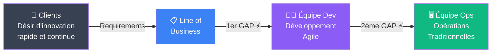
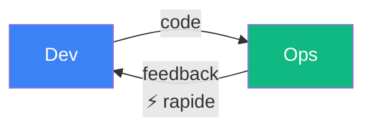
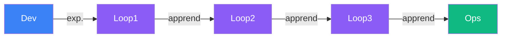

# DevSecOps

## Cours 1 — Introduction & Philosophie DevOps

Université de Rennes · IRISA / DiverSE

Olivier Barais — d'après les travaux de B. Combemale

---
layout: two-cols-header
layoutClass: my-slide
---

# Pourquoi, en tant que RSSI, comprendre les pratiques DevOps ?

::left::

**🗣️ Parler le langage de l'équipe technique**

La sécurité ne s'impose pas d'en haut. Pour faire adopter des pratiques (sécurité, traçabilité, reprise sur faute), le RSSI doit **comprendre le quotidien des équipes** : leur pipeline, leurs outils, leurs contraintes, leurs rythmes.

**🛠️ Intégrer la sécurité, pas l'ajouter**

Des exigences imposées *« à côté »* du travail créent de la **friction** et finissent contournées. Intégrées au workflow existant, elles deviennent des **habitudes durables**.

**🎯 Agir au bon endroit (shift-left)**

Le coût et l'impact d'une mesure dépendent de **l'endroit** où elle s'applique. Or, tout passe par le **pipeline de production logicielle** — le point de contrôle unique de l'équipe.

::right::

🧭

Comprendre pour convaincre, intégrer pour adopter

Le RSSI efficace **ne formule pas des interdits** : il rend les bonnes pratiques **indolores** et les fait porter par le pipeline.

---
layout: two-cols-header
layoutClass: practices-slide
---

# Les pratiques DevOps : des leviers pour vos objectifs de RSSI

::left::

**🔒 Sécurité**

Revue de code dans les **pull requests**, analyse de **dépendances** &amp; **SBOM**, gestion des **secrets**, durcissement de l'image finale.

**📜 Traçabilité**

**Git** &amp; historique des changements, **provenance** des artefacts, **logs de CI/CD** auditables : on sait *qui*, *quoi*, *quand*.

**♻️ Reprise sur faute**

Versions **immuables**, **builds reproductibles**, rollback rapide, **Infrastructure as Code** : on se reconstruit proprement après un incident.

::right::

🔁

La même chaîne sert production <em>et</em> sécurité

Comprendre ces pratiques, c'est pouvoir **les faire adopter**, **les auditer** et **réagir vite** — y compris quand le *pipeline lui-même* devient une cible (SolarWinds, XZ Utils…).

---

# Le modèle traditionnel de développement

**Le 1er fossé** — entre les besoins métier et ce que les développeurs produisent.

**Le 2ème fossé** — entre ce que les développeurs livrent et ce que les opérations déploient et maintiennent.

"We should quickly put it in production!"

"Do not confuse speed and haste. Production is serious!"

---
layout: center
class: text-center
---

# La tension structurelle entre Dev et Ops

### 👨‍💻 Dev
*veut livrer vite*

Nouvelles features · Changements fréquents · "Ça marche chez moi"

### 🖥️ Ops
*veut la stabilité*

Zero downtime · Pas de surprises · "La prod c'est sacré"

"Worked fine in DEV. OPS PROBLEM NOW."

Ce conflit d'objectifs est <strong>structurel</strong> dans le modèle traditionnel.

---
layout: center
class: text-center
---

# Qu'est-ce que DevOps ?

*"A <strong>software engineering practice</strong>*  
*that aims at unifying*  
 
***software development** (Dev)*  
*and **software operation** (Ops)."*

DevOps a été initialement formalisé par <strong>Patrick Debois</strong> en 2009,  
lors de la conférence <em>Velocity</em> de O'Reilly :  
<em>"10+ Deploys Per Day: Dev and Ops Cooperation at Flickr"</em>

---
layout: image-right
image: /devops_infinity_loop.png
backgroundSize: contain
---

# La boucle infinie du DevOps

Le symbole **∞** représente le flux ininterrompu entre Dev et Ops :

**Côté Dev (bleu) :**
- Plan → Code → Build → Test

**Côté Ops (orange) :**
- Release → Deploy → Operate → Monitor

Le retour d'information (**feedback**) remonte en permanence d'Ops vers Dev.  
C'est ce flux continu qui **élimine les silos**.

© Wikimedia Commons — DevOps toolchain

---

# Pourquoi DevOps ? Les motivations

### 🚀 Réduire le cycle de livraison
*time to market, lead time between fixes…*

Du commit à la production **le plus vite possible** et en toute confiance.

### 🧩 Approche fragmentée
*small increments vs. big bang*

Livrer souvent et en petites quantités réduit le risque et permet d'apprendre vite.

### 🔄 Mises à jour transparentes
*seamless updates*

Les utilisateurs ne "sentent" pas les déploiements. Zero downtime devient la norme.

### 🤝 Responsabilités partagées
*all in the same boat*

Dev et Ops partagent les objectifs, les métriques et **les responsabilités**.

---

# Responsabilités : Avant vs. Après DevOps

Pre-DevOps — silos séparés

Post-DevOps — responsabilités partagées

> *"You build it, You run it."* — **Werner Vogels**, Amazon CTO

---
layout: section
---

# Les 3 Voies fondamentales

## *The Three Ways* — Gene Kim, The DevOps Handbook

---

# DevOps : 3 Principes Fondamentaux

**1️⃣ System Thinking**  
*Pensée systémique*

Flux fluide de Dev vers Ops. Optimiser le **système entier**.

`Business → Dev → Ops → Client`

**2️⃣ Amplify Feedback**  
*Boucles de retour*

Feedback **rapide et constant** d'Ops vers Dev. Les problèmes remontent à la source.

`Ops ⟵ Feedback ⟵ Dev`

**3️⃣ Continual Learning**  
*Apprentissage continu*

Connaissance individuelle → **connaissance organisationnelle**.

`Dev ↔ Ops ↻ Learn`

Gene Kim — <em>The DevOps Handbook</em>

---

# 1ère Voie : La Pensée Systémique

**Objectif :** Flux de travail fluide et rapide de Dev vers Ops.

<v-clicks>

- **Rendre le travail visible** *(tableau visuel, lead time)*
- **Limiter le Work In Progress** — *"Stop starting. Start finishing."*
- **Réduire la taille des lots** et les intervalles de travail
- **Identifier et élever les contraintes** du système
- **Éliminer les obstacles et le gaspillage** dans le flux de valeur

</v-clicks>

💡 Si Ops est un goulot d'étranglement, accélérer Dev ne sert à rien. Optimiser la contrainte d'abord.

---

# 2ème Voie : Amplifier les Boucles de Retour

**Objectif :** Feedback rapide et constant de Ops vers Dev.

<v-clicks>

- **Travailler en sécurité** dans des systèmes complexes
- **Voir les problèmes** au moment où ils surviennent
- **Essaimer et résoudre** pour construire de la connaissance
- **Pousser la qualité vers la source** *(shift left)*
- **Optimiser** pour les centres de travail en aval

</v-clicks>

❌ <b>Sans feedback :</b> bug découvert 3 mois après, contexte perdu, correction coûteuse

✅ <b>Avec feedback :</b> problème détecté en minutes, correction ciblée et économique

---
layout: two-cols-header
---

# 3ème Voie : Expérimentation et Apprentissage Continu

::left::

**Objectif :** Culture d'apprentissage organisationnel permanent.

<v-clicks>

- **Culture de sécurité psychologique** (*psychological safety*)
- **Institutionnaliser l'amélioration** du travail quotidien
- **Transformer les découvertes locales** en améliorations globales
- **Injecter des patterns de résilience** dans le quotidien
- **Leaders** qui renforcent la culture d'apprentissage

</v-clicks>

::right::

✨ **Culture de l'échec constructif**
- Post-mortems **sans blâme** (blameless postmortems)
- **Game Day** : simuler des pannes pour apprendre
- **Chaos Engineering** (Netflix, Google)
- Feature flags & A/B testing

---
layout: section
---

# Le cadre CALMS

## La culture DevOps en 5 piliers

---

# CALMS : Le Cadre Conceptuel DevOps

<strong>🧠 C — Culture :</strong> Le fondement. Sans changement culturel, les outils ne changent rien.

<strong>⚙️ A — Automation :</strong> Builds, tests, déploiements, infrastructure — tout ce qui peut être automatisé doit l'être.

<strong>📉 L — Lean :</strong> Éliminer le gaspillage, réduire les lots, maximiser le flux de valeur.

<strong>📊 M — Measurement :</strong> Mesurer performances, déploiements, temps de récupération — sans mesure, pas d'amélioration.

<strong>🔗 S — Sharing :</strong> Partager les outils, les pratiques, les succès ET les échecs entre équipes.

---

# La Culture : attributs d'une organisation DevOps

**🏗️ Infrastructure As Code**
- Full Stack Automation
- Cloud Infrastructure APIs
- Reliability in software stack

**🔧 Application As Services**
- Service Orientation
- Versioned APIs
- Design for Failure

**👥 Dev/Ops/All As Teams**
- Shared Metrics & Monitoring
- Service Owners On-call
- CI/CD & **GameDay**

| Avant DevOps | Après DevOps |
|-------------|-------------|
| Équipes séparées, silos | Équipes pluridisciplinaires, transparence |
| "C'est leur problème" | "C'est notre problème" |
| Blâme en cas d'incident | Post-mortem blameless |

---
layout: section
---

# Mesurer le succès DevOps

## Les 5 métriques DORA

---

# Les 5 Métriques DORA

**🔧 Stabilité du service**

**Change Failure Rate** — % de changements causant panne (Elite : 0–15%)

**Time to Restore** — Temps pour restaurer après incident (Elite : &lt;1h)

**🚀 Développement logiciel**

**Lead Time** — Du commit au prod (Elite : &lt;1h)

**Deployment Frequency** — Fréquence de déploiement (Elite : plusieurs/jour)

**🔁 Reprise (5ᵉ métrique DORA)**

**Deployment Rework Rate** — % de déploiements non planifiés suite à un incident (ajoutée en 2024)

📖 Source : DORA — DevOps Research and Assessment (Google) · State of DevOps Report 2024

---

# DevOps vs. Agile : Complémentaires !

**Agile**
- Itérations courtes *(sprints 2-4 semaines)*
- Feedback du client intégré
- Équipes auto-organisées

**Limite :** Agile s'arrêtait à la livraison au client interne (staging). La production restait un "mur".

**DevOps complète Agile**

- Étend le flux continu **jusqu'en production**
- **Continuous Delivery** : chaque incrément est potentiellement déployable en prod
- Partage les responsabilités **au-delà du sprint**

**Agile** optimise le *comment* on développe.  
**DevOps** optimise le *comment* on livre et opère.  
Ensemble, ils forment un **flux de valeur bout en bout**.

---

# Les outils DevOps — Vue d'ensemble

**📝 Plan / Code**
- Jira, Confluence
- Git, GitHub/GitLab
- IDE + plugins

**🔨 Build**
- Maven, sbt, npm
- Gradle, Make

**🧪 Test**
- JUnit, Selenium
- SonarQube
- Trivy, Snyk

**🚀 Release / Deploy**
- Jenkins, GitHub Actions
- ArgoCD, Flux
- Codeship, CircleCI

**⚙️ Operate**
- Docker, Kubernetes
- Ansible, Chef, Terraform
- DC/OS, AWS

**📊 Monitor**
- Nagios, Datadog
- Splunk, Grafana
- Prometheus

⚠️ Ces outils seront détaillés <strong>cours par cours</strong>. Aujourd'hui : comprendre la philosophie, pas les outils.

---
layout: center
class: text-center
---

# À retenir

### DevOps, c'est avant tout…

<v-clicks>

✅ Un mouvement **culturel et philosophique**  
✅ Briser les silos entre Dev et Ops  
✅ Responsabilités **partagées**  
✅ Feedback **rapide** et continu  
✅ **Apprentissage** organisationnel permanent

</v-clicks>

### DevOps, ce n'est PAS…

<v-clicks>

❌ Un outil ou un produit  
❌ Un titre de poste  
❌ Juste de l'automatisation  
❌ Agile renommé  
❌ Réservé aux grandes entreprises

</v-clicks>

> *"You build it, you run it."* — **Werner Vogels**, Amazon CTO

Quand ceux qui construisent sont aussi responsables de l'opération, la qualité devient une **propriété émergente** du système.

---
layout: end
---

# Questions ?

**Ressources :**

- 📄 **Poly du cours** : [télécharger le poly (PDF)](https://raw.githubusercontent.com/barais/devsecops.module1/refs/heads/master/poly/poly.pdf)
- ➡️ **Cours suivant — Cours 2 — Gestion de Versions & Git** : [https://olivier.barais.fr/devsecops.module2](https://olivier.barais.fr/devsecops.module2)

Olivier Barais · Module DevSecOps

